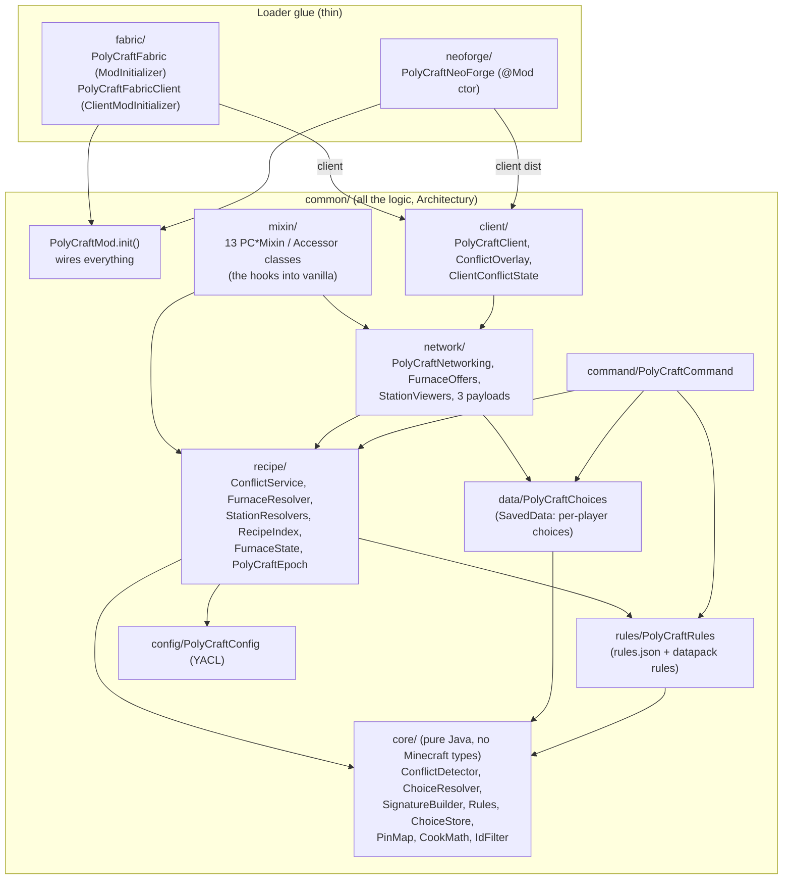
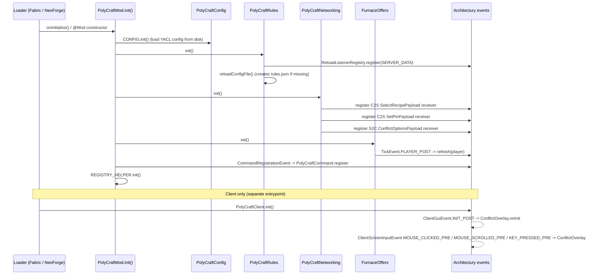
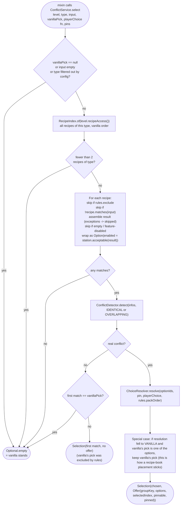
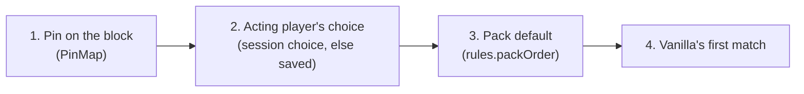
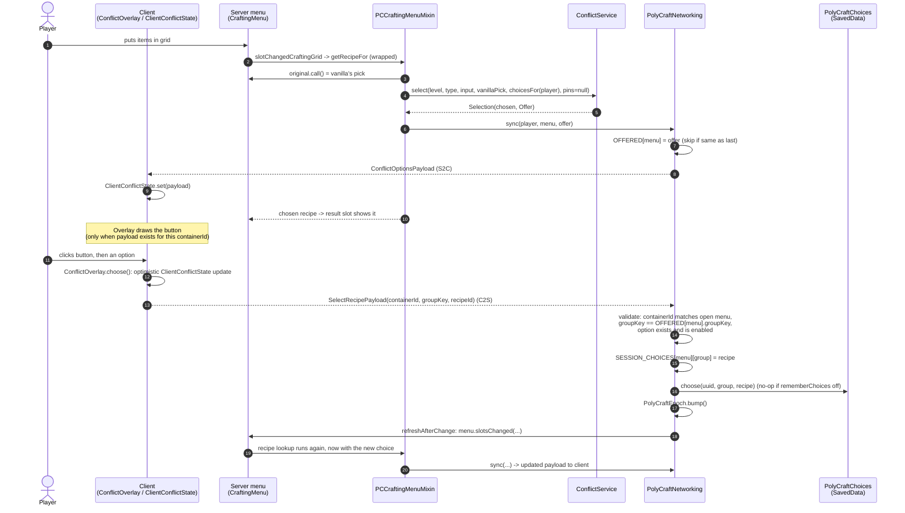
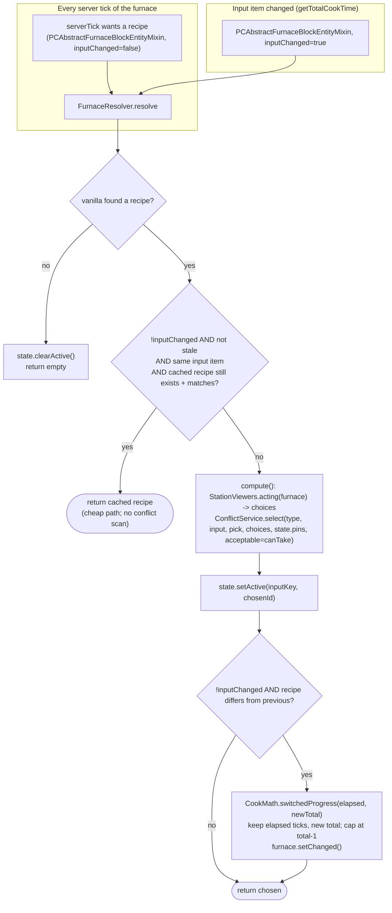
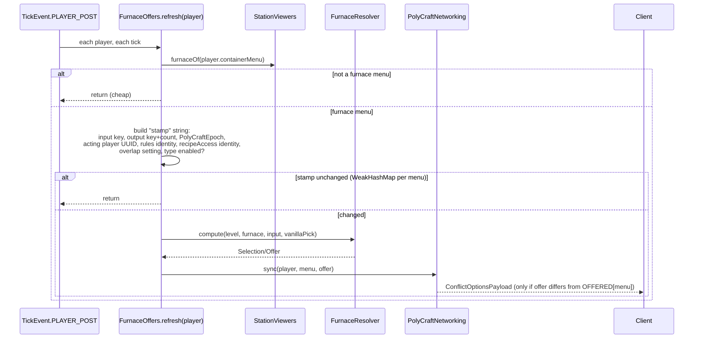
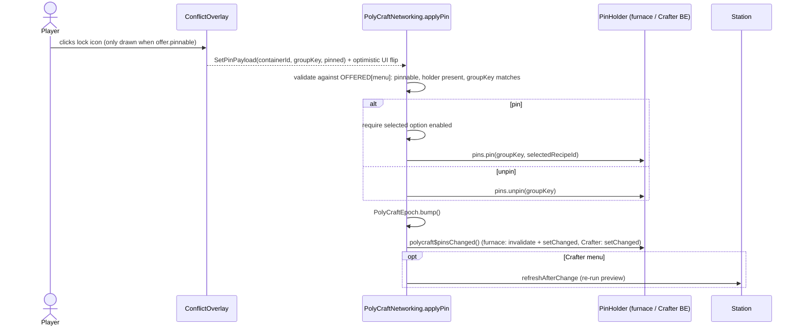
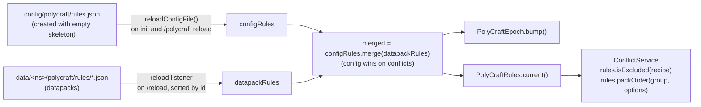
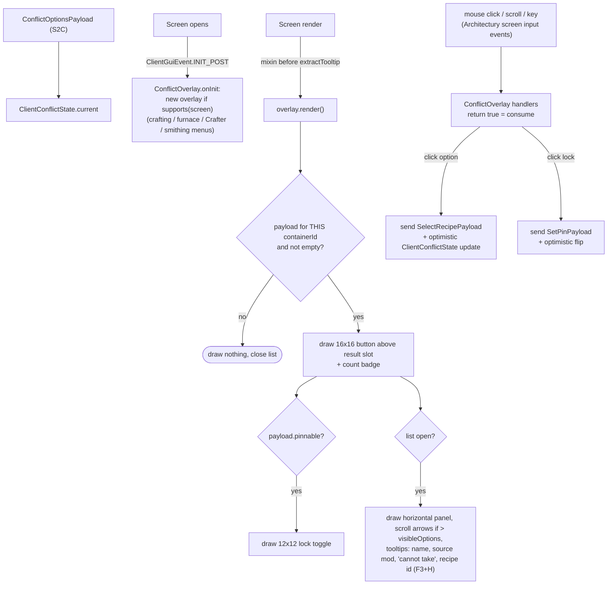

# PolyCraft internals

A developer's map of how PolyCraft works: which piece does which job, in response to which game event. For the
player-facing behaviour see `README.md`; for the *why* behind decisions see `DESIGN.md`. This file is about the *how*.

Diagrams are Mermaid (render in GitHub, VS Code's Markdown preview, and most editors).

> Written against the code as of release `26.2-1.0.0`. Paths are relative to `polycraft/common/src/main/java/com/chimericdream/polycraft/`
> unless noted. If you change a flow, update the matching diagram.

---

## 1. The one-paragraph version

Vanilla asks `RecipeManager` "which recipe matches this input?" and takes the first answer. PolyCraft **wraps those
lookups with mixins**. After vanilla gives its pick, PolyCraft (server-side only) re-runs the match against *every*
recipe of that type, decides whether the matches form a real **conflict** (same inputs, different outputs), and if
so swaps in the recipe the **pin → player → pack default → vanilla** order says to use. It then tells the player's
client what the options are, so a client-only **overlay** can draw a picker. The client sends back "use recipe X";
the server validates it against what it last offered, stores it, and re-runs the station's own update. Recipes are
never modified or removed.

---

## 2. Module layout

**Layering rule of thumb**

| Layer | May depend on | Notes |
|---|---|---|
| `core/` | JDK, Gson | No Minecraft types. This is what the JUnit tests in `fabric/src/test` hit. Recipes arrive as plain strings. |
| `recipe/` | `core/`, Minecraft, config, rules | The adapter between Minecraft recipe objects and the pure core. |
| `network/`, `data/` | `recipe/`, `core/` | Server state and the wire. |
| `mixin/` | everything above | Mixins stay tiny: wrap a call, delegate to `recipe/` or `network/`, and fall back to vanilla on any exception. |
| `client/` | `network/` payloads only | Never touches recipes; the client doesn't have them. |

The Fabric and NeoForge modules contain **no logic**. Both just call `PolyCraftMod.init()` (and
`PolyCraftClient.init()` on the client). On NeoForge the client init runs inside the mod constructor, because
Architectury registers its client event listeners from mod-bus events that fire before `FMLClientSetupEvent`.

---

## 3. Startup: what registers what

Mixins are declared in `common/src/main/resources/polycraft.mixins.json`. `defaultRequire: 1` means **every
injector must apply**, so a vanilla change that breaks a target fails loudly at launch instead of silently
disabling a station. Two mixins are client-only (the screen render hooks). The access widener
(`polycraft.accesswidener`) exposes `leftPos/topPos/imageWidth/imageHeight` on `AbstractContainerScreen` so the
overlay can position itself.

---

## 4. The core idea: signatures, groups, conflicts

### 4.1 Vocabulary

| Term | Meaning | Where |
|---|---|---|
| **Signature** | Canonical text for "what a recipe needs": type + ingredient layout. Mirrored/offset shaped recipes get the same one. | `core/Signature`, built by `core/SignatureBuilder`, fed by `recipe/RecipeIndex.computeSignature` |
| **Group key** | `type\|canonical` of the *vanilla-first* match's signature. This is the stable ID of "a conflict" and what's stored in saves, pins and `rules.json`. | `Signature.key()` |
| **Unique signature** | `unique:<recipeId>`. Used when ingredients can't be canonicalised. Never groups with anything. | `Signature.unique` |
| **Conflict** | ≥2 *distinct outcomes* among matching recipes. Distinct = different result item/components **or** different count. | `core/ConflictDetector` |
| **Offer** | What the player can choose right now: group key, options, selected index, pinnable?, pinned? | `ConflictService.Offer` |
| **Selection** | `(chosen recipe, optional Offer)`; the thing a mixin gets back. | `ConflictService.Selection` |
| **Pin** | A block-entity-level `groupKey -> recipeId`. | `core/PinMap` |
| **Epoch** | A global counter bumped whenever anything that could change a pick changes. | `recipe/PolyCraftEpoch` |

### 4.2 Signature building

`RecipeIndex.computeSignature` handles four vanilla shapes; everything else is `unique`.

| Recipe class | Builder | Canonical form |
|---|---|---|
| `ShapedRecipe` | `SignatureBuilder.shaped` | trimmed pattern; picks the lexicographically smaller of pattern / mirror |
| `ShapelessRecipe` | `SignatureBuilder.shapeless` | sorted ingredient keys |
| `SingleItemRecipe` (cooking, stonecutting) | `SignatureBuilder.ordered` | one slot |
| `SmithingRecipe` | `SignatureBuilder.ordered` | template ; base ; addition |
| anything else | `Signature.unique` | never grouped |

An ingredient key is the item id if there's exactly one item, else `set#<8-byte SHA-256 of sorted ids>`. So a tag
and a hand-written list of exactly the tag's items are the same ingredient. An ingredient that matches nothing
yields `null`, which poisons the whole recipe into `unique`.

### 4.3 Detection at runtime (`ConflictService.select`)

Key behaviours worth remembering:

* **Order matters.** `RecipeIndex` keeps recipes in `RecipeManager.getRecipes()` order, which is "vanilla's order",
  so `matches.getFirst()` is what vanilla would have picked and its signature defines the group key.
* **`IDENTICAL` vs `OVERLAPPING`** (`detectOverlappingInputs`). Identical: only matches sharing the winner's
  signature count. Overlapping: every recipe that matches the real grid counts, even with different ingredients.
* **Same outcome collapses.** Two recipes with the same result item *and* count are not a conflict
  (`RecipeInfo.sameOutcome`).
* **Everything is in a try/catch.** Any `RuntimeException` returns `Optional.empty()` (vanilla's pick). A bug here
  can cost a choice, never a craft.

### 4.4 Resolution order

Each step is skipped (not an error) if its recipe id isn't among the current options. `Rules.packOrder` builds
step 3 as: group-key default, then per-option-id defaults, then the global `priority` list.

---

## 5. Events → handlers

This is the "who reacts to what" table. Everything in the *server* rows runs on the server thread.

### 5.1 Vanilla hooks (mixins)

| Game event | Vanilla method hooked | Mixin | What PolyCraft does |
|---|---|---|---|
| Items change in a **crafting table** or the player's **2×2 grid** | `CraftingMenu.slotChangedCraftingGrid` → `RecipeManager.getRecipeFor` | `PCCraftingMenuMixin` | `ConflictService.select` with the player's choices, no pins; `PolyCraftNetworking.sync` to that player; return chosen recipe. |
| Player **takes the crafting result** | `ResultSlot.getRemainingItems` → `getRecipeFor` | `PCResultSlotMixin` | Re-run `select` so leftovers (buckets, bottles) come from the *chosen* recipe, not vanilla's. No sync. |
| Items change in a **smithing table** | `SmithingMenu.createResult` → `getRecipeFor` | `PCSmithingMenuMixin` | Same as crafting; player found via `PCItemCombinerMenuAccessor`. |
| **Furnace / blast furnace / smoker**: every server tick | `AbstractFurnaceBlockEntity.serverTick` → `CachedCheck.getRecipeFor` | `PCAbstractFurnaceBlockEntityMixin` | `FurnaceResolver.resolve(..., inputChanged=false)`: reuse the cached active recipe if still valid, else re-resolve. |
| Furnace **input item changes** | `AbstractFurnaceBlockEntity.getTotalCookTime` → `CachedCheck.getRecipeFor` | same | `FurnaceResolver.resolve(..., inputChanged=true)`: always re-choose, cook restarts. |
| Furnace **save / load** | `saveAdditional` / `loadAdditional` (TAIL) | same | `FurnaceState.save/load` (pins + active input/recipe). |
| **Crafter GUI** refreshes its preview slot | `CrafterMenu.refreshRecipeResult` → `CrafterBlock.getPotentialResults` | `PCCrafterMenuMixin` | `StationResolvers.crafter` with the viewer's choices + the block's pins; sync to viewer. |
| **Crafter fires** (redstone) | `CrafterBlock.dispenseFrom` → `getPotentialResults` | `PCCrafterBlockMixin` | `StationResolvers.crafter` with `crafterChoices` (the GUI viewer, else nobody) + pins. |
| Crafter **save / load** | `saveAdditional` / `loadAdditional` | `PCCrafterBlockEntityMixin` | `PinPersistence` saves/loads the pins. |
| **Campfire**: food placed | `CampfireBlockEntity.placeFood` → `getRecipeFor` | `PCCampfireBlockEntityMixin` | `StationResolvers.campfire`: no player, no pins, so pack default else vanilla. |
| Campfire: **cook finishes** | `CampfireBlockEntity.cookTick` → `CachedCheck.getRecipeFor` | same | Same resolver, so start and finish agree. |
| Any **menu click** (server) | `AbstractContainerMenu.clicked` (HEAD) | `PCAbstractContainerMenuMixin` | `StationViewers.touch(menu)`: stamps "who clicked last". |
| **Recipe-book click** on a crafting grid | `AbstractCraftingMenu.handlePlacement` (RETURN) | `PCCraftingPlacementMixin` | `recordBookChoice`: placing a recipe counts as choosing it. |
| Recipe-book click on a furnace | `AbstractFurnaceMenu.handlePlacement` (RETURN) | `PCFurnacePlacementMixin` | `FurnaceOffers.refresh` first (furnaces don't notify their menu), then `recordBookChoice`. |
| Screen **renders** (client) | `AbstractContainerScreen.extractRenderState`, just before `extractTooltip` | `PCAbstractContainerScreenMixin` | `ConflictOverlay.onRender`. Injected before the tooltip call so tooltips draw on top. |
| Recipe-book screen renders (client) | `AbstractRecipeBookScreen.extractRenderState`, same point | `PCAbstractRecipeBookScreenMixin` | Same, because that class overrides the render and skips the parent's. |
| (support) | n/a | `PCAbstractFurnaceMenuAccessor` | Exposes the menu's `container` so `StationViewers` can find the furnace block entity. |

### 5.2 Loader / Architectury events

| Event | Registered in | Handler |
|---|---|---|
| Mod init | `PolyCraftFabric` / `PolyCraftNeoForge` | `PolyCraftMod.init()` |
| `TickEvent.PLAYER_POST` | `FurnaceOffers.init` | `FurnaceOffers.refresh(player)`: keeps an open furnace screen's picker current |
| `CommandRegistrationEvent` | `PolyCraftMod.init` | `PolyCraftCommand.register` |
| Data-pack `/reload` (`SERVER_DATA` reload listener) | `PolyCraftRules.init` | `reloadDatapackRules` → rebuild merged rules → `PolyCraftEpoch.bump()` |
| Client: screen init | `PolyCraftClient.init` | `ConflictOverlay.onInit`: creates an overlay if the screen is a supported menu |
| Client: mouse click / scroll / key | `PolyCraftClient.init` | `ConflictOverlay.onMouseClicked/Scrolled/KeyPressed`; returning `true` swallows the event |
| C2S `SelectRecipePayload` | `PolyCraftNetworking.init` | `applySelection` |
| C2S `SetPinPayload` | `PolyCraftNetworking.init` | `applyPin` |
| S2C `ConflictOptionsPayload` | `PolyCraftNetworking.init` | `ClientConflictState.set` |

### 5.3 Commands (`/polycraft`)

| Subcommand | Permission | Does |
|---|---|---|
| `conflicts [mod]` | anyone | `RecipeIndex.allConflicts` (identical-input only, built from synthetic inputs), prints up to 20 |
| `export` | op | Same scan → writes `config/polycraft/conflicts.json` |
| `reload` | op | `PolyCraftRules.reloadConfigFile()` (datapack rules reload with `/reload`) |
| `reset` | anyone (self) | `PolyCraftChoices.reset(uuid)` |
| `reset <player>` | op | same, for another player |

---

## 6. Flow: the player picks a recipe (crafting table)

Why `SESSION_CHOICES` *and* `PolyCraftChoices`? The session map (keyed weakly by menu object) makes the choice apply
instantly and even when `rememberChoices` is off. The saved store is what makes it persist across menus,
logouts and restarts. `choicesFor(player)` checks session first, then saved.

### Trust boundary

The client is never trusted about *what exists*. `applySelection` only accepts a recipe id that is in the offer the
**server** last stored for that exact menu, and rejects disabled options. `applyPin` pins whatever the server
believes is currently selected, never a client-named recipe. A forged or stale packet is silently ignored.

---

## 7. Flow: furnace-family stations

Furnaces are the complicated station because they tick on their own, may have no viewer, and carry state on the
block.

### 7.1 State kept on the block (`FurnaceState`)

| Field | Purpose | Saved? |
|---|---|---|
| `pins` (`PinMap`, max 64) | per-group pinned recipe | yes (`polycraft_pins`) |
| `activeInput` | result-key of the input item the active recipe was chosen for | yes |
| `activeRecipe` | recipe id currently in effect | yes |
| `stale` | forces a re-choice on next lookup while still remembering what was active (so a *switch* is detected) | no |

Remembering `activeRecipe` is the reason closing the GUI (or a hopper feeding the furnace) does **not** silently flip
the output: re-resolution only happens when the input item changes, a viewer changes a selection or pin
(`polycraft$pinsChanged` → `invalidate()`), or the cached recipe stops matching.

> Note for future-me: a rules reload bumps `PolyCraftEpoch` but does **not** mark furnaces stale. Epoch only
> affects the `FurnaceOffers` change-stamp (below). A furnace mid-cook keeps its active recipe until its input
> changes or someone touches the picker/pin. If you ever want reload to re-resolve running furnaces, `invalidate()`
> is the hook.

### 7.2 Keeping the open furnace screen current (`FurnaceOffers`)

A furnace doesn't notify its menu when things change, so there's a poll:

The stamp is the whole trick: the expensive recipe scan only reruns when something relevant changed. Two layers of
de-dupe exist, stamp (skip the scan) and `sameOffer` in `sync` (skip the packet).

`compute()` is read-only: it reports what *would* be used. The block's actual active recipe is only written by
`resolve()`.

### 7.3 Who is the "acting player"? (`StationViewers`)

Unpinned furnaces/Crafters need "whose preference applies?"

* `PCAbstractContainerMenuMixin` stamps `LAST_CLICK[menu] = ++counter` on every server-side `clicked`.
* `StationViewers.acting(level, blockEntity)` scans `level.players()`, keeps those whose open menu's backing block
  entity **is** this station, and returns the one with the highest click stamp.
* Nobody viewing → `null` → player step skipped → pin, then pack default, then vanilla. This is what a
  hopper-fed furnace or a redstone-fired Crafter experiences.

`blockOf(menu)` works by menu type: `AbstractFurnaceMenu` (via the accessor mixin) or `CrafterMenu.getContainer()`;
the container must itself be a `BlockEntity`.

### 7.4 Pinning

Pins live on the block entity, are capped at 64 (oldest evicted), are saved with the block (NBT key
`polycraft_pins`), and sit at the top of the resolution order, so they beat every player's preference.

---

## 8. Crafter and campfire (stations without a "this player" story)

Both go through the shared `StationResolvers` and `ConflictService.select`:

| | Crafter | Campfire |
|---|---|---|
| Screen? | Yes (preview slot) | No |
| Pins? | Yes (`PinHolder`) | No (`pins = null`) |
| Player step | Viewer's choices for the GUI preview; on firing, the GUI viewer if any, else none | Never (`key -> Optional.empty()`) |
| Result | pin → (viewer) → pack default → vanilla | pack default → vanilla |
| Client sync | Yes, from the `refreshRecipeResult` wrap | n/a |

The Crafter has **two** hooks on purpose: the menu one (what the GUI *shows*, with the viewer's choices, plus sync)
and the block one (what it *crafts* when redstone fires). Both must land on the same answer or the preview would lie.
The campfire likewise hooks both `placeFood` (cook time) and `cookTick` (result) so they agree.

---

## 9. Where state lives (and for how long)

| State | Holder | Scope / lifetime | Persisted |
|---|---|---|---|
| Per-player remembered choices | `PolyCraftChoices` (`SavedData` on overworld storage) wrapping `core/ChoiceStore` | Per world; LRU, max 256 per player | Yes (saved-data id `polycraft:choices`, in the world's data storage; codec stores each player's list so LRU order survives restarts) |
| Choices made since a menu opened | `PolyCraftNetworking.SESSION_CHOICES` | `WeakHashMap` keyed by menu; vanishes with the menu | No |
| What the server last offered a menu | `PolyCraftNetworking.OFFERED` | Weak, per menu | No |
| Last-click ordering | `StationViewers.LAST_CLICK` | Weak, per menu | No |
| Furnace change-stamps | `FurnaceOffers.STAMPS` | Weak, per menu | No |
| Furnace pins + active recipe | `FurnaceState` on the block entity | Per block | Yes (block NBT) |
| Crafter pins | `PinMap` on the block entity | Per block | Yes (block NBT) |
| Recipe groups / signatures | `RecipeIndex` (static `current`) | Rebuilt when `RecipeManager` instance changes (every `/reload`); signatures lazily cached in a `ConcurrentHashMap` | No |
| Pack rules | `PolyCraftRules` (`configRules`, `datapackRules`, `merged`) | Global; config file wins over datapacks | Source files only |
| Client's current offer | `ClientConflictState.current` | One payload; only valid for the matching `containerId` | No |
| Overlay UI state (open, scroll, cursor) | `ConflictOverlay` instance per screen | Per screen instance | No |
| Config | `PolyCraftConfig` (YACL) | Global | Yes (YACL config file) |

`PolyCraftEpoch` is the glue: bumped by choice changes, pin changes, resets and rules rebuilds; currently read only
by `FurnaceOffers` to decide when to recompute.

---

## 10. Pack-author data: rules and config

`Rules.parse` never throws: bad JSON, unknown keys or malformed ids are logged via the warn callback and skipped.
`Rules.merge`: priorities concatenate (this one first, de-duped), excludes union, group defaults overlay (this one wins).

Config (`PolyCraftConfig`, via chimeric-lib's `YaclConfig`):

| Key | Read by |
|---|---|
| `detectOverlappingInputs` | `ConflictService` (mode), `FurnaceOffers` stamp |
| `enabledRecipeTypes` / `disabledRecipeTypes` | `ConflictService` first check; `RecipeIndex.allConflicts`; via `IdFilter` (deny wins, empty allow = all) |
| `visibleOptions` | `ConflictOverlay` (clamped 3–12 by `ConfigLimits`) |
| `showConflictBadge` | `ConflictOverlay.drawButton` |
| `rememberChoices` | `PolyCraftChoices` get/set (off = session-only choices) |
| `debugLogging` | **declared and shown in the config screen, but nothing reads it yet** (the design's "log groups on reload" isn't wired up) |

---

## 11. The client side

The client holds **no recipes**, only the last `ConflictOptionsPayload`, which carries recipe ids and a ready-made
result `ItemStack` for each option.

Notes:

* The overlay is **self-contained**: it draws and handles input itself rather than adding widgets to the vanilla
  screen, which is why no screen classes are subclassed. The only vanilla touch is the render-order mixin.
* Button position is relative to the **result slot** of whatever menu is open (`resultSlot()` switch), 22px above
  it. The panel prefers above the GUI, falls to below, and is clamped to the window.
* All art is fixed-size PNGs under `assets/polycraft/textures/gui/`; the scroll arrows reuse vanilla's
  `recipe_book/page_*` sprites.
* Keyboard: ←/→ move cursor, Enter/Space choose, Esc closes. Disabled options (`enabled=false`) can't be chosen.
* A server without the mod can't reach this code at all, since nothing sends the payload. A client without the mod
  on a modded server is skipped by `NetworkManager.canPlayerReceive(...)` in `sync`, so that player simply gets
  vanilla behaviour. (The server-side swap still happens, since it's keyed on saved/session choices, but a
  client that can't receive offers has no way to make any.)

---

## 12. Failure policy

PolyCraft's rule: **never break a craft.**

* `ConflictService.select` catches `RuntimeException` → returns "vanilla stands".
* Every furnace/campfire/Crafter mixin wrapper has its own try/catch that returns the vanilla `Optional`.
* Stale ids (recipe removed, datapack off, typo in rules) are skipped in `ChoiceResolver`, never thrown on.
* `ChoiceStore` deliberately keeps ids whose recipe vanished (so a temporarily disabled datapack doesn't wipe choices);
  `prune` is the explicit cleanup.
* `Rules.parse` never throws; `PolyCraftRules` falls back to `Rules.EMPTY` on IO errors.
* `assembleSafely` swallows exceptions from exotic modded `assemble()` implementations.
* Mixins are `require: 1`, so the opposite policy applies at *launch*: if a hook can't attach, fail loudly.

---

## 13. Tests, by layer

| Layer | Where | Covers |
|---|---|---|
| Pure core (JUnit) | `fabric/src/test/java/.../test/core/` | `ChoiceResolverTest`, `ConflictDetectorTest`, `SignatureBuilderTest`, `RulesParserTest`, `PlayerChoicesTest`, `ConfigTest`, `PerfTest` |
| In-game (Fabric GameTest) | `fabric/src/gametest/java/.../test/` | `CraftingGameTest`, `FurnaceGameTest`, `StationsGameTest`, `CommandGameTest` |
| Manual | `TEST_PLAN.md` | UI, multi-viewer, Crafter, campfire, etc. |

`PolyCraftNetworking.applySelection` / `applyPin` are `public` specifically so game tests can drive them without a client.

---

## 14. "I want to change X, where do I go?"

| Goal | Start at |
|---|---|
| Change what counts as a conflict | `core/ConflictDetector`, `RecipeInfo.sameOutcome` |
| Change how recipes are grouped / keyed | `core/SignatureBuilder`, `RecipeIndex.computeSignature` (**changing a key orphans saved choices, pins and rules**) |
| Change precedence (pin / player / pack / vanilla) | `core/ChoiceResolver` (+ `Rules.packOrder` for step 3) |
| Support a new vanilla-style station | New mixin wrapping its `getRecipeFor`, call `ConflictService.select`; add to `polycraft.mixins.json`; if it has a screen add it to `ConflictOverlay.supports` + `resultSlot()`, `PolyCraftNetworking.refreshAfterChange`, and `StationViewers.blockOf` if it's a block with viewers |
| Support a new recipe shape in grouping | `RecipeIndex.computeSignature` and `syntheticResult` (otherwise it is `unique`, but still works for overlapping detection) |
| Change the picker's look or input | `client/ConflictOverlay` and the PNGs; no server changes |
| Change what the client is told | `ConflictOptionsPayload` (bump compat thinking: both sides must agree on the codec) |
| Change furnace mid-cook behaviour | `core/CookMath`, `FurnaceResolver.resolve` |
| Make rules reload re-resolve running furnaces | call `FurnaceState.invalidate()` from the rules rebuild (see §7.1 note) |
| Add a config option | `PolyCraftConfig` field + `Defaults` + YACL option; read via `PolyCraftConfig.get()` |
| Add a command | `PolyCraftCommand.register` |
